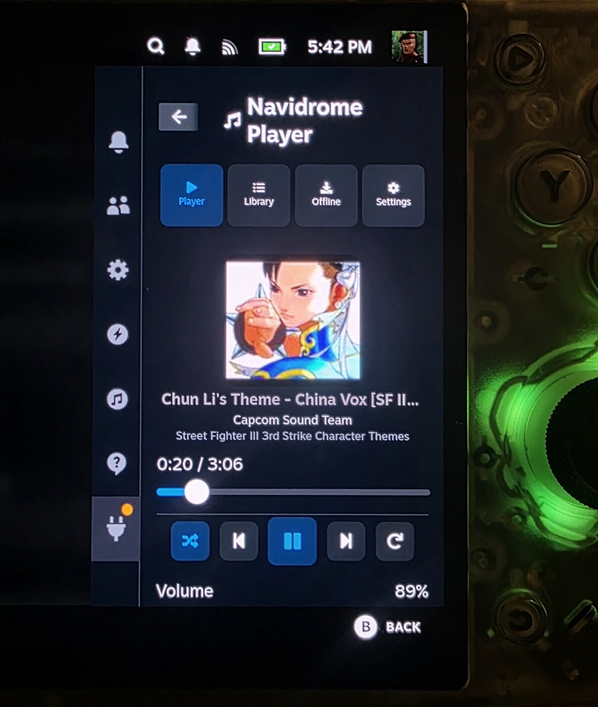

# Navidrome Player for Decky Loader

[](https://github.com/abduznik/decky-navidrome-player/actions/workflows/ci.yml)
[](https://github.com/abduznik/decky-navidrome-player/releases/latest)
[](LICENSE)
[](README.md#arm64-support)

Stream your [Navidrome](https://www.navidrome.org/) library from the Steam Deck
Quick Access Menu — including while a game is running — with a real player UI,
volume and shuffle controls, and a size-capped offline cache.

Built for both **arm64** and **x86_64**. The plugin is pure Python + TypeScript
with no compiled binaries, so there is nothing architecture-specific to port.



*Running on a **Retroid Pocket Nova** (arm64): cover art, seek bar, transport
controls, shuffle/repeat and volume, directly in the Decky Quick Access Menu.*

> Status: **v0.1.3 beta**, verified on a Retroid Pocket Nova (arm64). The
> backend has 39 tests covering authentication, caching, range requests,
> downloads and the plugin API. The same code builds and tests natively on
> x86_64.

## Features

- **Navidrome / Subsonic API** login with token authentication (password is
  never sent in the URL).
- **Player** in the Quick Access Menu: cover art, seek bar, play/pause,
  previous/next, queue preview.
- **Volume** slider, plus shuffle and repeat modes.
- **Random radio**: one button starts an endless shuffled mix; when the queue
  runs out it asks Navidrome for another random batch.
- **Browse**: search, playlists, albums, and per-album/playlist play, shuffle
  and download-all. Album filtering by **recently added**, **recently played**,
  **most played**, **random**, **artist** or **alphabetical**, selected with
  controller-friendly filter buttons that stay on the same screen.
- **Hide playlists** with a button in the Library or Settings; the choice is
  saved between sessions.
- **Download queue panel** in the Offline tab: per-track progress, queued and
  finished jobs, and failure messages. Per-download notifications are gone, so
  batches don't spam toasts or sounds.
- **Controller-first navigation**: every action is a focusable Steam item, and
  horizontal button rows are explicit focus groups so the D-pad/joystick can
  move up/down out of a row instead of being trapped in it.
- **Offline cache** with a configurable limit (default **1 GiB**, adjustable
  from 0.25 GB to 32 GB in the UI).
  - Automatically caches the song that starts playing (can be disabled).
  - LRU eviction keeps older automatic cache entries inside the limit.
  - **Manual downloads** are pinned and never evicted automatically, even when
    the limit is lowered.
- **Offline playback** from the Offline tab, including after a Steam/Decky
  restart, because download metadata is persisted.
- **Streaming quality** selector (original or 64–320 kbps transcoding).
- **Scrobbling** to Navidrome after 10 seconds of playback.
- **Local media server** with HTTP Range support, so seeking works for both
  cached and streamed tracks. Bound to `127.0.0.1` and protected by a random
  per-session path token.

## Install

### From a release (recommended)

Download the archive for your device from the
[Releases page](https://github.com/abduznik/decky-navidrome-player/releases):

- `navidrome-player-<version>-arm64.zip`
- `navidrome-player-<version>-x86_64.zip`

Both files contain the same plugin payload; use the name that matches your
device only for clarity. Unzip it so the `navidrome-player` folder lands here:

```text
~/homebrew/plugins/navidrome-player/
```

For example:

```bash
unzip navidrome-player-0.1.0-arm64.zip -d ~/homebrew/plugins/
```

Then restart Decky Loader (or reboot the device) and open the Quick Access Menu
→ Decky → Navidrome Player.

### From source

Requirements: Node.js 22+, pnpm 9, Python 3.11+.

```bash
pnpm install
pnpm build
./scripts/package.sh arm64        # or x86_64; detected from uname if omitted
./scripts/deploy.sh               # copies into ~/homebrew/plugins
```

`scripts/dev-install.sh` does all of the above (install, typecheck, build, run
backend tests, package for the current machine, deploy).

## Configure

Open the **Settings** tab and enter:

| Setting | Example |
| --- | --- |
| Server URL | `http://192.168.1.10:4533` or `https://music.example.com` |
| Username | your Navidrome username |
| Password | your Navidrome password |

Press **Test**, then **Save**. The URL is normalised automatically (a missing
scheme becomes `http://`).

Other settings:

- **Streaming quality** — original or a transcoded bitrate. Transcoding reduces
  bandwidth and cache usage; manually downloaded files use the same quality.
- **Cache songs while playing** — on by default. Only the current track is
  prefetched, not the whole queue, to avoid surprise bandwidth use.
- **Cache limit** — 0.25–32 GB in the UI (default 1 GB). Lowering it evicts
  automatic cache only; pinned downloads stay and the UI shows when the total is
  over the limit.
- **Show playlists** — hide the playlists section from the Library if you only
  browse albums. Saved immediately and restored on the next session.

### Where files live

| Data | Path |
| --- | --- |
| Settings | `$DECKY_PLUGIN_SETTINGS_DIR/settings.json` |
| Audio cache | `$DECKY_PLUGIN_RUNTIME_DIR/cache/audio/` |
| Cache manifest | `$DECKY_PLUGIN_RUNTIME_DIR/cache/manifest.json` |

On a standard Decky install those usually expand to
`~/homebrew/settings/navidrome-player/` and
`~/homebrew/data/navidrome-player/` (the exact folder name is chosen by
Decky). The cache path is also shown in the Settings tab.

**Password storage:** the password is stored in plain text in the plugin's
local settings file, because a Subsonic client must be able to derive
`md5(password + salt)` for every request. It never leaves the device except as
that salted token to your own server. Protect the settings file accordingly.

## How it works

```text
┌──────────────────────────────┐
│ Decky QAM (React/TS)         │
│  player + library + offline  │
└──────────────┬───────────────┘
               │ decky callables / events
┌──────────────▼───────────────┐
│ Python backend               │
│  ┌────────────┐  ┌─────────┐ │
│  │ Subsonic   │  │ Cache   │ │
│  │ client     │  │ (LRU)   │ │
│  └────┬───────┘  └────┬────┘ │
│       │               │      │
│  ┌────▼───────────────▼────┐ │
│  │ 127.0.0.1 media server  │ │
│  │ /m/<token>/stream/<id>  │ │
│  │ /m/<token>/art/<id>     │ │
│  └─────────────────────────┘ │
└──────────────┬───────────────┘
               │ HTTP + Subsonic token auth
        ┌──────▼──────┐
        │  Navidrome  │
        └─────────────┘
```

- The backend exposes cached files through `http.server` on a random loopback
  port. CEF can then use a normal `<audio>` element, including `Range` seeking,
  which also works after going offline.
- Streamed (non-cached) tracks are proxied through the same local server, so the
  frontend never sees credentials.
- The cache manifest is a small JSON file; filenames are SHA-1 hashes of song
  ids, so arbitrary Subsonic ids cannot escape the cache directory.
- API calls run in worker threads (`asyncio.to_thread`) so the Decky event loop
  is never blocked by the network.

### Subsonic endpoints used

`ping`, `getRandomSongs`, `getPlaylists`, `getPlaylist`, `getAlbumList2`,
`getAlbum`, `search3`, `stream`, `getCoverArt`, `scrobble`.

Other Subsonic-compatible servers should work, but Navidrome is the tested
target.

## arm64 support

There is **no architecture-specific build step**. The plugin consists of:

- a Rollup bundle of JavaScript (`dist/index.js`), and
- pure Python modules using only the standard library (`urllib`, `http.server`,
  `hashlib`, `json`, `threading`, …).

CI runs on native runners for both architectures:

| Artifact | Runner |
| --- | --- |
| `x86_64` | `ubuntu-24.04` |
| `arm64` | `ubuntu-24.04-arm` |

Each job runs the TypeScript typecheck, the Rollup build, all 39 backend tests,
and packages the plugin. The `arm64` zip is therefore built and tested on arm64,
not cross-compiled. No `@rollup/rollup-linux-x64-*` package is pinned in
`package.json`; Rollup resolves its optional native binary for the runner's
architecture.

## Development

```bash
pnpm install
pnpm typecheck
pnpm test:backend      # python3 -m unittest discover -s tests -v
pnpm build
pnpm watch             # rebuild on change
```

`scripts/dev-install.sh` runs the full loop for the current machine: install,
typecheck, build, backend tests, package and deploy to `~/homebrew/plugins`.
See [CONTRIBUTING.md](CONTRIBUTING.md) for the development workflow and the
rules that keep the plugin arm64-safe.

Project layout:

```text
src/
  index.tsx            plugin entry + tab shell + download events
  api.ts               typed decky callables + local media URLs
  state/player.ts      persistent <audio> singleton (survives QAM close)
  components/          NowPlaying, Library, Downloads, Settings
py_modules/
  plugin.py            Decky-facing async methods
  subsonic.py          stdlib Subsonic client + mappers
  cache.py             LRU cache, pinned downloads, JSON manifest
  downloads.py         background download queue
  server.py            loopback HTTP server with Range support
  config.py            settings validation/persistence
tests/                 backend tests (39 tests, no external services)
scripts/               package, deploy, dev-install
```

The frontend keeps a module-level `Audio` object, so closing the Quick Access
Menu does not stop playback. `onDismount` pauses and releases it when Decky
unloads the plugin.

## Releasing

Releases are built by GitHub Actions from the tag, never uploaded by hand:

```bash
# bump package.json + CHANGELOG.md first
git commit -am "Release v0.1.3"
git tag -a v0.1.3 -m "Navidrome Player 0.1.3"
git push origin main v0.1.3
```

The [release workflow](.github/workflows/release.yml) then:

1. runs the typecheck, Rollup build and backend tests on native `x86_64` and
   `arm64` runners;
2. packages `navidrome-player-<version>-{x86_64,arm64}.zip`;
3. publishes a GitHub release with both zips and `SHA256SUMS`.

The two archives contain the same pure Python/TypeScript payload, but the arm64
artifact is genuinely built and tested on an `aarch64` runner.

## Troubleshooting

| Symptom | Fix |
| --- | --- |
| "Cannot reach Navidrome" | Check the URL from another device on the same network. HTTPS with a self-signed certificate is not supported by the Python client. |
| Login test succeeds but playback fails | Try **Settings → Streaming quality → 128 kbps**. The source format may not be decodable by Steam's CEF. |
| A downloaded song won't play offline | Only songs in the **Offline** tab are guaranteed offline. Playlists/albums still need the server for browsing. |
| Controller focus feels stuck | Update to the latest release. Multi-button rows are explicit focus groups; report the exact row if a direction still won't exit. |
| Plugin doesn't appear in Decky | Confirm the folder is `~/homebrew/plugins/navidrome-player/`, then restart `plugin_loader` or reboot. |
| Cache size is over the limit | Pinned manual downloads are never evicted. Raise the limit or delete downloads in the **Offline** tab. |

Logs are written by Decky to `~/homebrew/logs/navidrome-player/`
(`plugin.log`).

## Prior art

At the time of writing there was no Navidrome/Subsonic plugin in the Decky
plugin database and no GitHub project that combined Decky QAM integration, a
size-capped cache, manual downloads and arm64. Two standalone projects use the
"Navidrome" name and are worth knowing about:

- [austinwilcox/navideck](https://github.com/austinwilcox/navideck) — a C++/Qt6
  + libmpv controller-first player for Game Mode. Has a download manager with a
  cap, but is a separate app (no QAM overlay) and needs a Qt/mpv build per
  architecture.
- [senar030/navideck](https://github.com/senar030/navideck) — a browser/PWA
  Navidrome client with a Deck-friendly touch UI, not a Decky plugin.

This project intentionally stays inside Decky so music can be controlled over a
running game.

## Limitations

- Audio decoders are whatever Steam's CEF supports (MP3, AAC/M4A, FLAC, Ogg
  Opus and WAV generally work). Unsupported formats fail with a toast.
- The Offline tab works without the server; browsing/search/playlists require
  Navidrome to be reachable.
- Downloads use one worker and no resume. An interrupted download restarts next
  time; partial `.part` files are removed.
- Scrobbles are sent only while online and are best-effort.
- No gapless playback, lyrics, ReplayGain or Android-native UI.
- Cached audio is exposed to local processes through a tokenized loopback URL;
  it is not encrypted at rest.

## Contributing

Bug reports and pull requests are welcome. Please read
[CONTRIBUTING.md](CONTRIBUTING.md) first, and use the issue templates when
opening a report. Security issues should follow [SECURITY.md](SECURITY.md).

## License

BSD-3-Clause. See [LICENSE](LICENSE).
